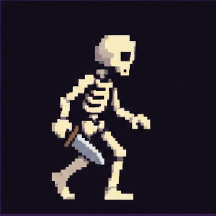

# Desktop Skeletons

A Windows tower defense in Unity 6 that I'm building with a friend. A horde of chibi skeletons pours out of a portal and walks toward the Heart. You build a maze, place traps, keep them fed through supply lines, and hold out through siege waves. When the Heart finally falls, the souls you earned stay on your account and buy a stronger start next run.

This repo is a showcase. The game is in active development and the source is private, so here's what it is and how it's built. Happy to walk through the code on a call.

**Team:** 2 developers ([DenyaSolyara](https://github.com/DenyaSolyara), [Mokryi](https://github.com/Mokryi)) · **Engine:** Unity 6, C# · **Size:** ~32,000 lines of C#

---

## The game

- **Siege waves.** Wave 1 sends 200 skeletons, wave 2 sends 600, wave 3 sends 1,200, and it keeps growing from there. A director bends the flow with rushes and lulls but never changes the count.
- **Mazes.** Skeletons path to the Heart on their own. You can make the route as long and nasty as you like, but you can never seal it.
- **10 trap types.** Spikes, saws, ice, flamer, minigun, gas, tesla, rockets, plus spring and plate pushers that throw the horde back. Guns need supply lines: ammo, rockets, and gas from ports on the board, power for the tesla, fire through an igniter.
- **Wear and repair.** Traps wear down and break. You fix them with a hammer, using scrap from crates the director drops mid-fight.
- **Meta progression.** Souls carry over between runs and build up a city. The Arsenal unlocks traps, the Workshop adds slots, the Forge adds damage, and so on. There are checkpoints every 5 waves.

## How it's built

**A horde of 12,000 live enemies**
Every creature is a row in native arrays. Burst jobs move them, and the whole horde draws as a single mesh, as do the corpses. A spatial grid answers the traps' "who's in range" queries. The arrays hold up to 65,536 rows, and a siege keeps up to 12,000 alive at once.

**Flow-field pathfinding**
One flow field runs out from the Heart over the player's blocks. Building is checked against it, so a maze can never cut off the route. Automated nav tests run in Unity batch mode and have to print `NAV TESTS: PASS`.

**Balance as data**
Every number (damage, speed, price, cooldown) lives in one ScriptableObject. An external admin panel tunes those values live while the game runs, with no rebuild needed.

**Performance tooling**
A built-in stress test adds 1,000 skeletons every 6 seconds until FPS drops. It logs every frame over 40 ms to CSV, broken down by which system ate the time. Shaders and sprites get pre-warmed so the first hit doesn't hitch.

**Everything from code**
The single scene is generated by an editor script. Traps, pipes, blocks, and UI are drawn in code, 8-bit sound effects are synthesized at startup, and a Python pipeline turns AI-generated pixel art into animation data.

## How we work: two people, two AI agents, one repo

Each of us works with our own Claude Code agent on the same codebase. To keep that from turning into chaos:

- **One game, many switches.** New ideas go in behind feature flags you can toggle in an in-game admin menu. Nobody keeps their own long-lived version of the game.
- **Small branches, merged often.** Each idea gets a `feat/<who>-<idea>` branch that lives a day or two, then goes into `dev`. `main` only takes tagged, playable checkpoints, which ship as GitHub Releases.
- **A shared brain for the agents.** A handoff doc and a rules file live in the repo, and both agents read them at the start of every session. It covers what the game is, how it's built, the gotchas, and a running change log. Agent memory stays on one machine, but the repo is shared.
- **A launcher.** It pulls from GitHub, builds in Unity batch mode, shows build errors in red, runs the game, and keeps perf logs from the last 20 sessions.

## My part

Roughly 80% of the commits, across gameplay, traps and supply lines, the economy and city meta progression, UI, tooling, and the team workflow above. Mokryi led the horde simulation.
